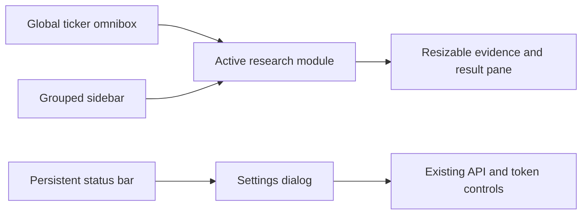

# Research Console Workstation Shell

- Author: Codex
- Status: Implementing
- Created: 2026-10-12
- Updated: 2026-10-12
- Authority: `D:\workspace\InvestmentJournalApp\docs\design\research-console-workstation-shell.md`

## Objective

Turn the classic research console from a long control page into a compact analyst workstation where the current security, active research module, result stream, and system health remain visible without unnecessary scrolling.

## Goals

- Keep the selected ticker global and reachable with `Ctrl/Cmd+K`.
- Group the existing twenty modules into stable research, analysis, operations, and data navigation groups.
- Keep the active module in the central scroll area and the result stream in a resizable right pane.
- Move connection credentials out of the primary workspace into an explicit settings dialog.
- Compress service health into a persistent status bar without hiding detailed status text.
- Preserve every existing element ID, form contract, API call, and safety boundary.
- Support desktop workstations and a 390x844 mobile viewport without horizontal overflow.

## Non-goals

- Replacing the static console with React.
- Changing backend endpoints, storage formats, research policy, or authentication.
- Adding live-order controls or making simulation controls resemble live execution.
- Sending notifications, placing orders, or changing account configuration.

## User flow

1. The analyst focuses the omnibox with `Ctrl/Cmd+K`, selects a company, and submits.
2. The sidebar changes only the central module view; the ticker and result pane stay in context.
3. A workflow action writes progress and evidence to the right result pane.
4. The bottom bar exposes compact health signals. Detailed connection controls open only from Settings.

## Interface contract

- Existing `.tab[data-tab]` controls and `.panel#<tab>` targets remain the navigation contract.
- The global ticker input remains associated with `#dashboardForm` through the HTML `form` attribute, so `dashboardForm.elements.ticker` remains compatible.
- Existing status IDs and output IDs are preserved.
- Workstation-only behavior lives in `workstation.js`; research behavior remains in `console.js`.
- Pane width and collapsed navigation preference are local UI preferences only.

## Responsive behavior

- `>= 1180px`: sidebar, central workspace, and resizable evidence pane are visible together.
- `760px - 1179px`: the evidence pane becomes a bottom dock and the sidebar remains compact.
- `< 760px`: navigation becomes an overlay drawer, the ticker stays in the top bar, and the result dock can collapse.
- Forms use two or three columns where space allows, then become one column on mobile.

## Accessibility and safety

- All shell controls have visible focus states, labels, and at least 40px desktop / 44px mobile targets.
- The settings dialog traps focus through the native `<dialog>` element and can be closed with Escape.
- Token fields use password presentation; the value is never copied into labels or logs.
- The result pane is an `aria-live` region through its existing output elements.
- Research, simulation, and live execution remain visibly separated as required by `DESIGN.md`.

## Verification targets

- Existing static contract and click-smoke tests pass.
- JavaScript syntax and console asset hashes pass.
- Desktop viewport has no page-level horizontal overflow; the center and result panes scroll independently.
- 390x844 viewport has no character-by-character Korean wrapping or horizontal overflow.
- Keyboard: `Ctrl/Cmd+K`, Escape, tab navigation, sidebar buttons, Settings open/close.

## Rollout and rollback

- Rollout changes only HTML structure, CSS, and a new shell behavior module.
- Existing research code is not migrated, so rollback is a single UI commit revert.
- If a shell enhancement fails, the underlying tab buttons, forms, IDs, and API bindings remain intact.
